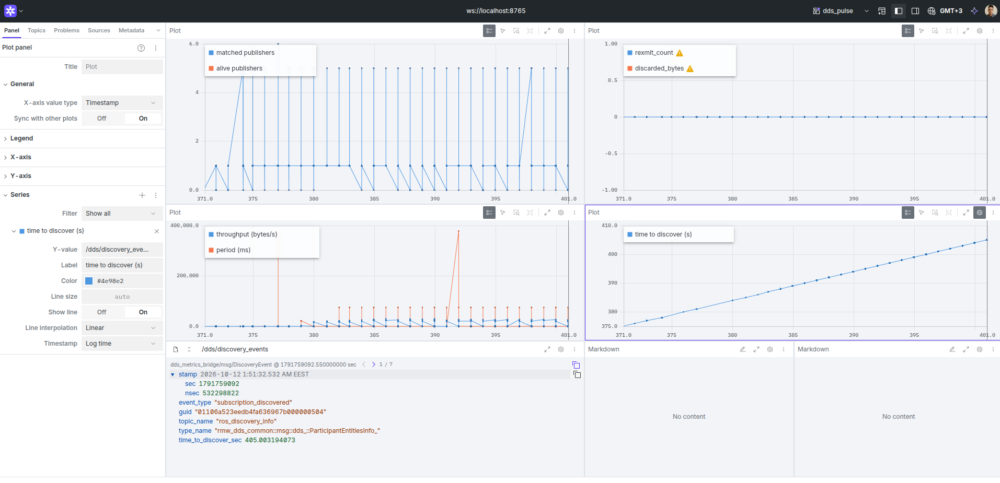

# ros2-dds-pulse

**Live DDS transport health for a ROS 2 fleet, as ordinary ROS 2 topics you can chart in [Foxglove Studio](https://foxglove.dev/).**

Most ROS 2 developers stop at the application layer: write nodes, leave the DDS defaults alone, and find out about a flaky network the hard way — a robot that "randomly" misses `cmd_vel` messages, or a fleet that takes 30 seconds to notice a new AGV joined the domain. `ros2-dds-pulse` is a single C++ node that watches the DDS layer itself and turns it into dashboards an engineering manager can glance at, not log lines an engineer has to grep.


*`foxglove_layouts/dds_pulse.json` open in Foxglove Studio against a running fleet — matched publishers, retransmits/discards, throughput/period, and discovery time, all updating live.*

---

## Quickstart (3 minutes)

```bash
git clone <this-repo> ros2-dds-pulse
cd ros2-dds-pulse
colcon build --symlink-install
source install/setup.bash

ros2 launch dds_metrics_bridge dds_metrics_bridge.launch.py
```

Then open [Foxglove Studio](https://foxglove.dev/), connect to **`ws://localhost:8765`** (Foxglove WebSocket), and **Layout → Import from file →** [`foxglove_layouts/dds_pulse.json`](foxglove_layouts/dds_pulse.json) to get the dashboard above. That layout also ships inside the built package itself (`share/dds_metrics_bridge/foxglove_layouts/dds_pulse.json`), so anyone who installs this package always has the dashboard that matches the topics their build actually publishes — it isn't a separate download that can drift out of sync with the code.

---

## What it publishes

| Topic | Message | What it tells you |
|---|---|---|
| `/dds/heartbeats` | `dds_metrics_bridge/msg/Heartbeat` | Per-topic matched/alive publisher counts — "is this robot actually connected?" |
| `/dds/retransmitted_packets` | `dds_metrics_bridge/msg/RetransmittedPacket` | RTPS retransmit/discard counters — "is this network dropping packets?" |
| `/dds/latency_bytes` | `dds_metrics_bridge/msg/LatencyBytes` | Per-topic throughput and inter-arrival period |
| `/dds/discovery_events` | `dds_metrics_bridge/msg/DiscoveryEvent` | One row per newly-seen DDS participant/endpoint, with time-to-discover |

Every field is documented inline in the `.msg` files under [`src/dds_metrics_bridge/msg/`](src/dds_metrics_bridge/msg/) — including exactly which DDS mechanism each number comes from.

---

## Architecture: how do you actually get DDS internals out of Cyclone DDS?

This is the part worth reading if you're evaluating the code, not just the dashboard.

eProsima **Fast DDS** ships a dedicated [Statistics Module](https://fast-dds.docs.eprosima.com/en/latest/fastdds/statistics/statistics.html) that publishes heartbeat counts, retransmits, and latency as built-in DDS topics — vendor convenience that makes this problem easy, *if* your fleet runs Fast DDS. This project's target fleet runs **Cyclone DDS** instead (the common choice for large multi-robot domains, to avoid Fast DDS's heavier discovery traffic at scale), and Cyclone has no equivalent statistics topics. Its native stats API, `dds_get_statistics()`, is explicitly documented as *"a quick-and-dirty provisional interface"* that only reports counters for **entities the calling process itself owns** — there is no call to read another process's writer/reader statistics. So a single bridge node genuinely cannot query "how many packets did AGV-2's Nav2 process retransmit" the way a Fast DDS listener could.

Rather than fake that number, `dds_metrics_bridge` combines three sources that are each honestly within reach, through fully public, documented APIs:

1. **DDS built-in discovery topics** (`DCPSParticipant` / `DCPSPublication` / `DCPSSubscription`) — part of the DDS specification itself, so, unlike per-entity statistics, they're genuinely cross-process and vendor-neutral. SPDP/SEDP discovery traffic flows over the full reliable RTPS protocol (HEARTBEAT/ACKNACK/retransmit), so `dds_get_statistics()` on *these* built-in readers gives real, fleet-wide numbers for the discovery layer specifically — which is exactly the kind of "too many robots joining a noisy multicast domain" problem this tool is meant to catch. See [`discovery_stats_watcher.cpp`](src/dds_metrics_bridge/src/discovery_stats_watcher.cpp).
2. **A synthetic self-probe** — a tiny reliable pub/sub pair the node creates and owns on its own topic, via Cyclone's native C API (compiled from a plain IDL file with `idlc`, see [`idl/Probe.idl`](src/dds_metrics_bridge/idl/Probe.idl)), acting as an always-on canary for "is DDS transport on this domain healthy right now" — the same principle as a network ping. See [`self_probe.cpp`](src/dds_metrics_bridge/src/self_probe.cpp).
3. **Public rclcpp/rmw event APIs** (`matched_callback`, `liveliness_callback`, and raw CDR byte size via `rclcpp::SerializedMessage`) on real fleet topics, discovered dynamically via `get_topic_names_and_types()` and matched against a configurable regex allow-list. These are stable, vendor-neutral rclcpp APIs — not a hack into `rmw_cyclonedds_cpp`'s private internals. See [`dds_metrics_bridge_node.cpp`](src/dds_metrics_bridge/src/dds_metrics_bridge_node.cpp).

If you *are* running Fast DDS, porting source (1) and (3) is unnecessary — you'd point this node at Fast DDS's `fastdds_statistics_backend` instead and get richer per-remote-entity data directly. The architecture here is deliberately the harder, more defensible path for the DDS vendor that doesn't give you that shortcut.

---

## Visualizing with Foxglove

1. Run `ros2 launch dds_metrics_bridge dds_metrics_bridge.launch.py` (starts the bridge **and** `foxglove_bridge` on port 8765).
2. In Foxglove Studio: **Open connection → Foxglove WebSocket → `ws://localhost:8765`**, then **Layout → Import from file → `foxglove_layouts/dds_pulse.json`**.

`foxglove_bridge` only streams a topic's actual data once some panel subscribes to it — connecting doesn't push your whole ROS graph over the wire. The launch file also sets `topic_whitelist` to `.*dds.*|.*tf.*`, so unrelated (and potentially heavy, e.g. camera/LiDAR) topics never even appear in Foxglove's topic list for this bridge's connection. Tighten or loosen that in [`dds_metrics_bridge.launch.py`](src/dds_metrics_bridge/launch/dds_metrics_bridge.launch.py) for your own project.

### Reading the dashboard

- **Heartbeats** — matched/alive publisher counts per watched ROS topic. A count dropping to 0 while a robot is supposed to be running usually means a DDS discovery or network problem, not a crashed node — check Discovery Events first.
- **Retransmitted Packets** — `rexmit_count` / `discarded_bytes` from this node's own DDS discovery readers and its synthetic self-probe (see Architecture above). **If this spikes, your network is dropping packets.**
- **Throughput / Latency** — bytes/sec and inter-arrival period per topic.
- **Discovery Events** — one row per newly-seen DDS participant or endpoint, with how long it took this bridge to see it. Long tails usually mean multicast/discovery-storm issues on a crowded `ROS_DOMAIN_ID`.

### Demo: inducing real packet loss

To see the "Retransmitted Packets" panel actually move instead of sitting at zero:

```bash
sudo tc qdisc add dev lo root netem loss 2% delay 50ms 10ms   # induce loss on loopback
# ... watch the dashboard react ...
sudo tc qdisc del dev lo root netem                            # remove it afterwards
```

This affects all loopback traffic on the machine for as long as it's active, so scope it to a short demo window. With it active you'll see something like:

```
$ ros2 topic echo /dds/retransmitted_packets
---
stamp: {sec: 1760000042, nanosec: 0}
source: self_probe_writer
rexmit_count: 184        # was 3 a second ago
rexmit_bytes: 47104
rexmit_lost_count: 2
throttle_count: 0
---
```

---

## Configuration

All parameters are on the `dds_metrics_bridge` node:

| Parameter | Default | Meaning |
|---|---|---|
| `watched_topic_patterns` | `cmd_vel`, `odom`, `amcl_pose`, `scan`, `fleet_state`, `task_state`, `/tf`, `/tf_static` (regex) | Which topics get matched/liveliness/throughput tracking |
| `rescan_period_sec` | `5.0` | How often to re-scan `ros2 topic list` for newly-launched topics |
| `report_period_sec` | `1.0` | How often `/dds/heartbeats` and `/dds/latency_bytes` are published |
| `probe_period_sec` | `0.2` | How often the self-probe canary writes a sample |

```bash
ros2 run dds_metrics_bridge dds_metrics_bridge_node --ros-args \
  -p watched_topic_patterns:="['.*lidar.*', '.*imu.*']"
```

---

## Repository layout

```
ros2-dds-pulse/
├── src/dds_metrics_bridge/     # the ROS 2 package
│   ├── idl/Probe.idl           # native Cyclone DDS type for the self-probe
│   ├── msg/                    # the four /dds/* message definitions
│   ├── include/ src/           # node + DiscoveryStatsWatcher + SelfProbe
│   └── launch/                 # bridge + foxglove_bridge together
└── foxglove_layouts/
    └── dds_pulse.json          # the dashboard — also installed to share/
```

## License

Apache-2.0, see [LICENSE](LICENSE).
